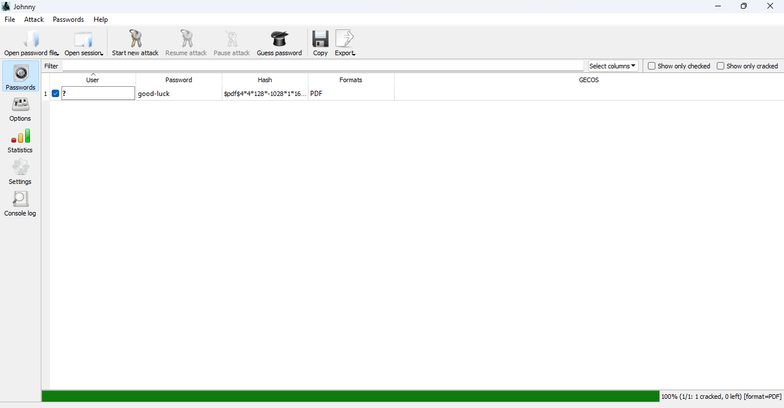
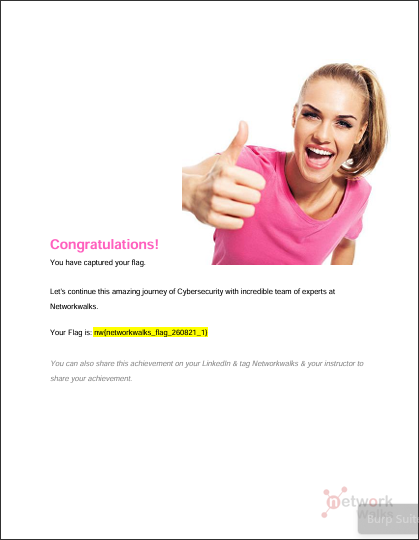
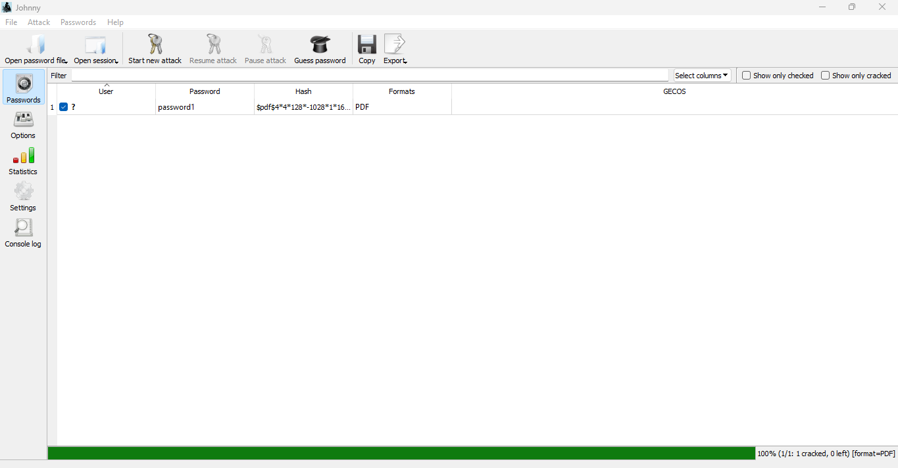
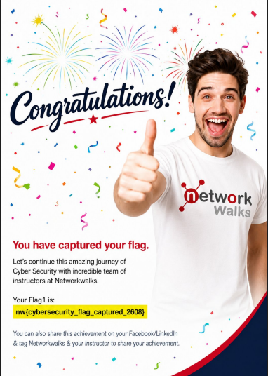
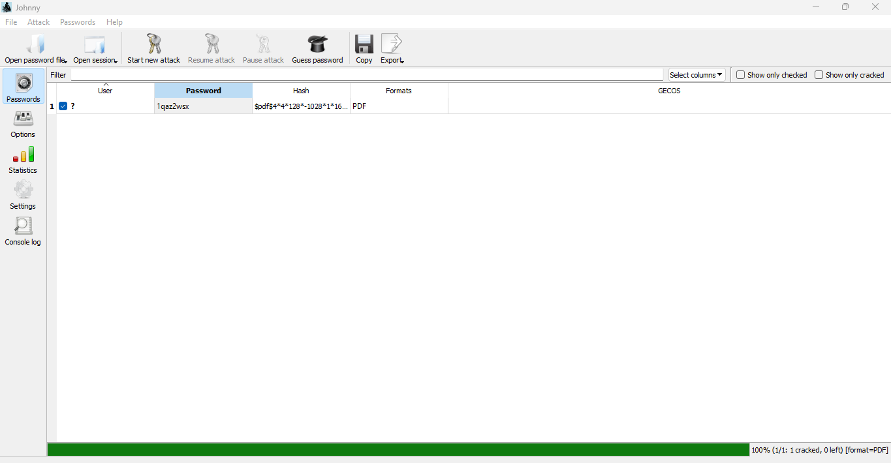
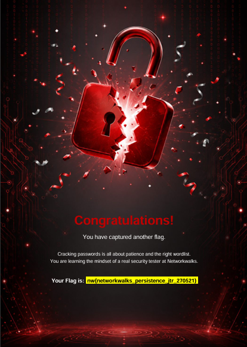
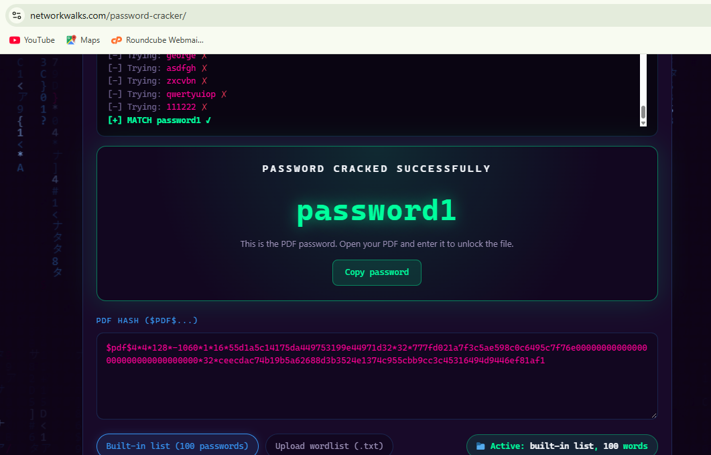
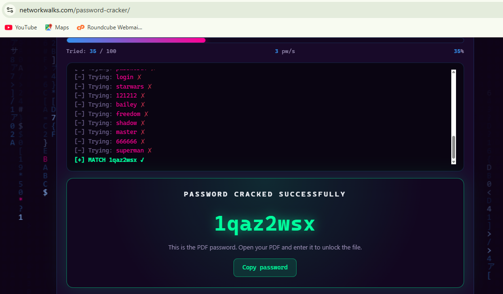

<h1 align="center">🔓 Password Cracking with JTR & NetworkWalks Tools</h1>

<b>Recovering password-protected PDF passwords using dictionary attacks</b>

  
  
  
  
  

---

## 📌 Project Overview

Password cracking is the process of recovering a password from stored data or a protected file. Security professionals use it to test how strong a password is and to demonstrate why weak passwords are risky.

When a file like a PDF is locked, its password is stored as a **hash**, a scrambled value that represents the password. To recover it, the hash is extracted from the file and run through a cracking tool that tries words from a wordlist (a **dictionary attack**) until it finds a match.

This project covers two modules:

- **PM1:** Cracking password-protected PDFs using **John the Ripper (JTR)** and its GUI, **Johnny**, across three rounds of increasing password complexity.
- **PM2:** Cracking a PDF password using NetworkWalks' own free online **Hash Calculator** and **Password Cracker** tools.

⚠️ **Disclaimer:** All files cracked here were course-provided lab files for education only. These techniques should never be used on a file or account you don't own or don't have explicit permission to test.

---

## 🎯 Objectives

- Extract a crackable hash from a password-protected PDF
- Run a dictionary attack against the hash using John the Ripper / Johnny
- Run the same kind of attack using NetworkWalks' browser-based tools
- Recover the original password in each case
- Understand how password complexity affects how quickly a password is cracked

---

## 🧩 Part 1 (PM1): Cracking with John the Ripper & Johnny

John the Ripper was installed along with its GUI, **Johnny**, which was pointed to `john.exe`. For each locked PDF, the password hash was extracted (`$pdf$...` format), loaded into Johnny as a password file, and attacked using Johnny's built-in wordlist.

### Round 1: Simple password

Johnny recovered the password `good-luck` from the first hash.

Capturing this flag confirmed the password was correct.

### Round 2: Common password pattern

The second PDF's hash was cracked to reveal `password1`, a very common password pattern.

### Round 3: Keyboard-pattern password

The third PDF's hash was cracked to reveal `1qaz2wsx`, a keyboard-walk pattern that still appears in common wordlists.

---

## 🧩 Part 2 (PM2): Cracking with NetworkWalks' Own Tools

The same kind of attack was repeated using NetworkWalks' free browser-based tools instead of installed software:

1. The locked PDF was uploaded to the **Hash Calculator** ([networkwalks.com/hash-calculator](https://networkwalks.com/hash-calculator/)), which parses the file locally in the browser and extracts its `$pdf$...` hash.
2. The hash was pasted into the **Password Cracker** ([networkwalks.com/password-cracker](https://networkwalks.com/password-cracker/)), which runs a dictionary attack against it using a built-in wordlist — the same idea John the Ripper uses.

**First run:** the tool matched the hash to the password `password1`.

**Second run:** a different hash was tested, and the attack was caught mid-progress (35%, 35 of 100 words tried) before it matched the password `1qaz2wsx` — the same password recovered with Johnny in Round 3.

---

## 📊 Summary

| Round | Method | Password Recovered |
|---|---|---|
| PM1 – Round 1 | John the Ripper + Johnny | `good-luck` |
| PM1 – Round 2 | John the Ripper + Johnny | `password1` |
| PM1 – Round 3 | John the Ripper + Johnny | `1qaz2wsx` |
| PM2 | NetworkWalks Hash Calculator + Password Cracker | `password1` |

All passwords were recovered using the same underlying approach: extract the hash, then test wordlist entries against it until one matches.

---

## 🛡️ Why This Matters

- A hash is a **one-way** function; encryption is two-way and reversible with the right key, but a hash cannot be reversed, only guessed against.
- Even "mixed-looking" passwords like `1qaz2wsx` (a keyboard walk) or `password1` (a common pattern plus a digit) are cracked almost instantly, because they already exist in standard wordlists.
- A password's real strength comes from length, randomness, and avoiding predictable patterns, not just mixing in a digit or two.
- Security professionals use this exact process to audit password strength on systems they are authorized to test.

---

## 💡 What I Learned

- How to extract a password hash from a locked PDF using both a desktop tool and a browser-based tool.
- How a dictionary attack works: testing wordlist entries one by one against a hash until a match is found.
- How to set up and use John the Ripper's GUI, Johnny.
- Why predictable patterns (keyboard walks, word-plus-number) offer very little real protection.
- The real-world cost of weak passwords, which is why strong, unique passwords matter for every account.

---

## ⚠️ Disclaimer

This project is for **education and authorized testing only**. The PDF files used were provided by the course specifically for this exercise. Never attempt to extract or crack a password hash from a file, account, or system you do not own or do not have explicit written permission to test.

---

## 👤 Author

**Kannou **
Cybersecurity Student, NetworkWalks B084M

---

## 📌 Project Information

**Program Name:** Cybersecurity at Networkwalks | **Batch:** B084M | **Week:** 03 | **Project:** PM1 & PM2 – Password Cracking | **Repository:** GitHub
